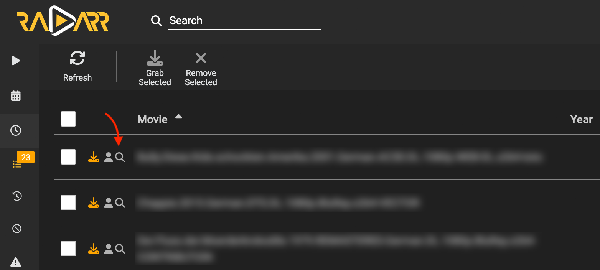

# ArrActivityQueueSearch

Adds a search button for unlinked activity queue elements in **Radarr** and **Sonarr**.



## What it does

For queue rows that are not matched cleanly, the script will:

- add a `search button` next to the row status icon
- move the existing `user/details` button next to the status icon
- Clicking the search icon will:
  - parses the movie/ tv show name from the filename
  - replaces `.`, `_`, and `-` with spaces
  - replaces `ae`, `oe`, `ue` with `ä`, `ö`, `ü`
  - removes season and episode information like `S01`, `S01E02` or `Season 1`
  - trims everything after the first detected year
  - opens the normalized term in the Radarr/ Sonarr add/search page

## Installation

1. Install the [Tampermonkey](https://www.tampermonkey.net/) browser extension.
2. Try installing the script automatically by opening the raw [`ArrActivityQueueSearch.user.js`](ArrActivityQueueSearch.user.js) URL. Tampermonkey should open its install screen. If this fails:
   1. Click the Tampermonkey icon → `Create a new script`
   2. Replace the template content with the contents of [`ArrActivityQueueSearch.user.js`](ArrActivityQueueSearch.user.js).
   3. Save the script (Ctrl+S).
   4. Visit/reload your Radarr/ Sonarr queue page.
3. Configure the script according to the next section

## Configuration

This script is intentionally configured with generic default `@match` entries for the default ports.

If your Radarr/Sonarr instances are reachable on different IPs, hostnames, or ports, configure Tampermonkey so the script is injected on those URLs too:

- Open the `Tamplermonkey Dashboard` → `Installed Userscripts` and edit the script.
- Open the scripts `Settings` tab and add `Includes/Excludes` → `User matches`: `IP:Port` your Sonarr and Radarr instances are reachable at.

> [!NOTE]
> You can also edit the script header and add extra `@match` lines manually but those will be overridden when the script is updated.

Examples:

- HostIP:Port

    ```text
    http://192.168.178.50:7878/activity/queue
    http://192.168.178.50:8989/activity/queue
    ```

- .local

    ```text
    radarr.local:7878/activity/queue
    sonarr.local:8989/activity/queue
    ```

- reverse proxy

    ```text
    https://radarr.home.arpa/activity/queue
    https://sonarr.home.arpa/activity/queue
    ```

> [!NOTE]
> Adding User matches without disabling Original matches does **not** replace the default rules; it only adds to it.

## Disclaimer

This project was realised with the help of LLMs.
